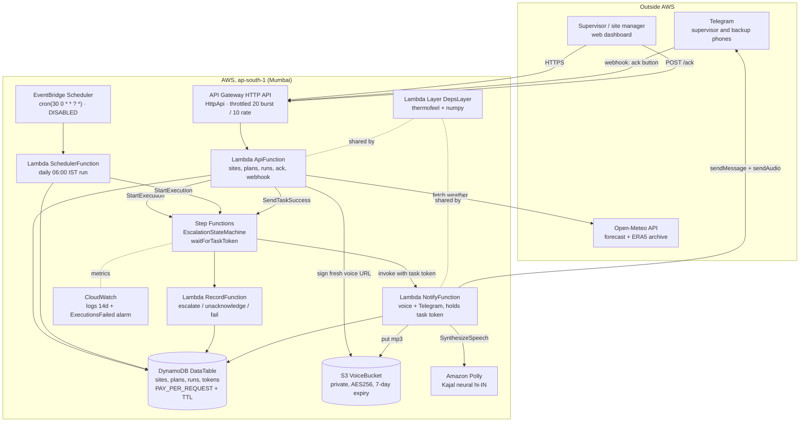

# Architecture

Every box below is a resource that exists in `backend/template.yaml`, except where it is
explicitly marked as not deployed.

## Diagram

**Not deployed yet:** AWS Amplify Hosting for the dashboard. It is not a resource in
`template.yaml`; it is created by `backend/scripts/deploy_frontend.py` as a manual deployment.
Until then the dashboard runs locally against the live API.

## One run, in eight steps

1. A run starts, either from the dashboard (`POST /sites/{site_id}/run`) or from
   **EventBridge Scheduler** waking **SchedulerFunction** at 06:00 India time.
2. **ApiFunction** builds today's plan: it fetches hourly weather from **Open-Meteo**, computes
   WBGT per hour with the shared `shramshield_core` library, and classifies each hour against
   the ACGIH limits. The plan is cached in **DynamoDB** with a TTL.
3. The run row is written to **DynamoDB** with status `STARTED`, and a **Step Functions**
   execution begins.
4. The state machine invokes **NotifyFunction** with a **task token** and then waits. It does
   not poll; the workflow is suspended until someone calls back.
5. **NotifyFunction** sends the plan text to **Amazon Polly** (`Kajal`, neural, `hi-IN`), writes
   the MP3 to the private **S3** bucket, stores the object key on the run, and sends the
   message plus the audio to the supervisor on **Telegram** with an inline Acknowledge button.
   The run becomes `WAITING_ACK`.
6. If the supervisor presses the button, Telegram calls the webhook on **API Gateway**;
   **ApiFunction** marks the run `ACKNOWLEDGED` with a conditional DynamoDB write and calls
   `SendTaskSuccess`, which ends the workflow. `POST /ack` from the dashboard does the same.
7. If nobody answers within `ack_timeout_seconds`, Step Functions times the task out, runs
   **RecordFunction** to record `escalated`, and notifies the **backup** contact the same way.
   A second timeout records `UNACKNOWLEDGED`.
8. Every transition appends an event to the run in **DynamoDB**, so the dashboard timeline and
   the judges see exactly what happened and when.

## Design decisions

**Why WBGT rather than air temperature.** Heat stress is about whether a body can shed heat,
which depends on humidity, radiation and wind as much as on temperature. Our own replay makes
the point: Delhi had 268 work hours at or above 40 C but only 320 dangerous hours, while
Chennai had 6 hours reaching 40 C and 679 dangerous hours. A thermometer fires in the dry city
and stays silent in the humid one.

**Why deterministic rules and not an LLM.** Every safety number comes from a published physical
model (Liljegren, via ECMWF's `thermofeel`) and a published screening table (ACGIH as
summarised by CCOHS). The same inputs always give the same output, the thresholds are auditable
against a printed table, and a validator written independently of the engine re-checks every
plan. A language model cannot offer any of that, and a wrong work/rest number is a safety
problem, not a style problem. AI was used to write code, not to decide the numbers.

**Why Step Functions for the wait.** Waiting for a human for 10 or 15 minutes is the hard part.
A Lambda that sleeps would burn billed time and die at the 15-minute limit. Step Functions'
`waitForTaskToken` suspends the workflow at no compute cost, applies the timeout itself, and
leaves a visible execution graph that proves what happened — which is also the best evidence we
can show a judge.

**Why a web acknowledgement next to Telegram.** Telegram can fail: no signal, bot blocked, chat
id not configured, or a demo on a conference network. `POST /ack` closes the same run through
the same task token, so a live demo can always complete. It also records `acked_via` so the two
routes are distinguishable afterwards.

**Why Polly Hindi.** The person who must act on the plan is a site supervisor, and the message
needs to be understood quickly, possibly by someone who reads little. A spoken Hindi message
carries further than text. `Kajal` is a neural `hi-IN` voice available in the Mumbai region, so
the audio is generated in the same region as the rest of the stack.

**Why the voice URL is signed on every read.** S3 presigned URLs last one hour, and Lambda
signs with temporary credentials, so a URL minted at notification time is dead when anyone
reopens the run later. The run stores the S3 **object key** instead, and the API signs a new
URL on each read.

## Known limitations

- Weather is a city-point model value of roughly 10 to 25 km, not a measurement at the
  worksite. Microclimate — bitumen, metal roofs, trenches, heavy clothing — is not modelled.
- The screening limits assume an 8-hour day and are not a medical standard that fits every
  individual.
- The Hindi message text is machine-drafted and has **not** been reviewed by a native speaker.
- CORS is `AllowOrigins: "*"` and the demo key is embedded in the frontend bundle at build
  time, so it is a demo-grade control, not a real secret. Mutating routes are additionally
  throttled.
- `DynamoDBCrudPolicy` grants broader actions than some functions use, scoped to the one table.
- The daily schedule is `DISABLED`; runs are started by hand so nothing fires unexpectedly
  during judging.
- The backtest compares two methods on the same historical weather. It is **not** validated
  against heat illness cases.
